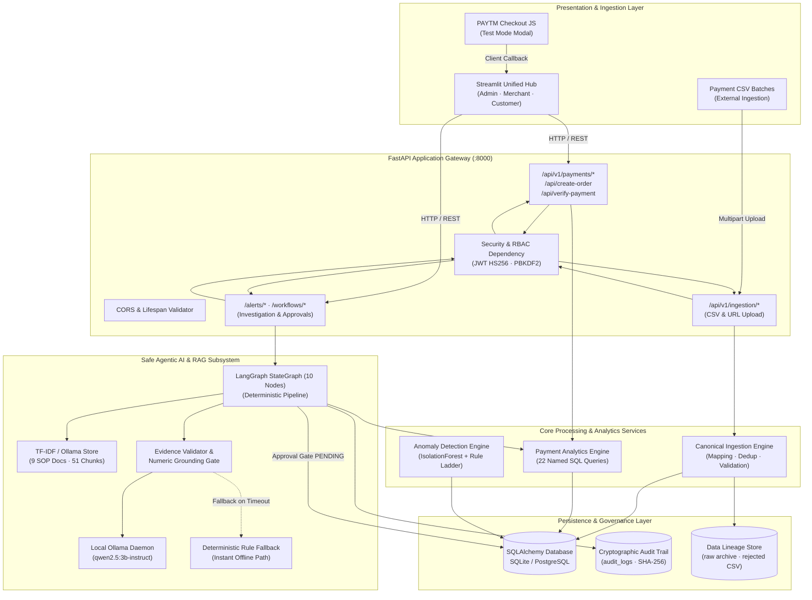
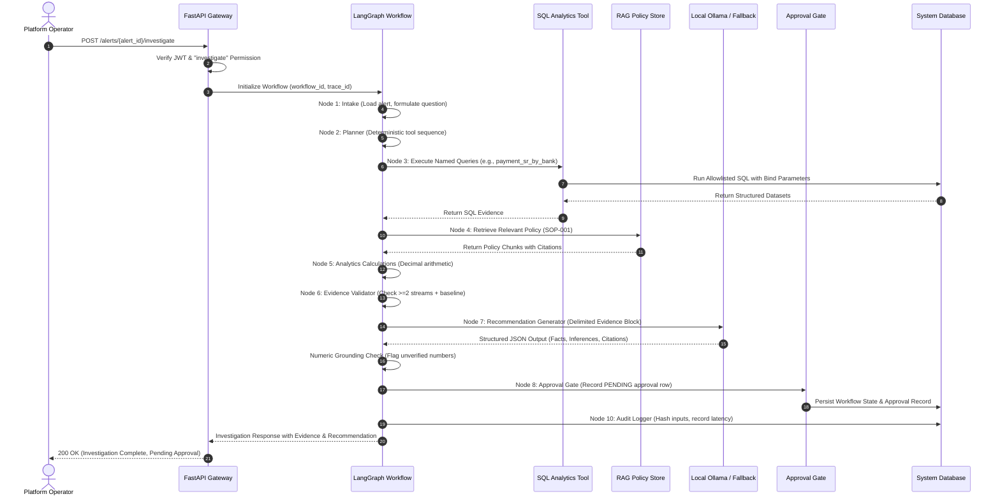
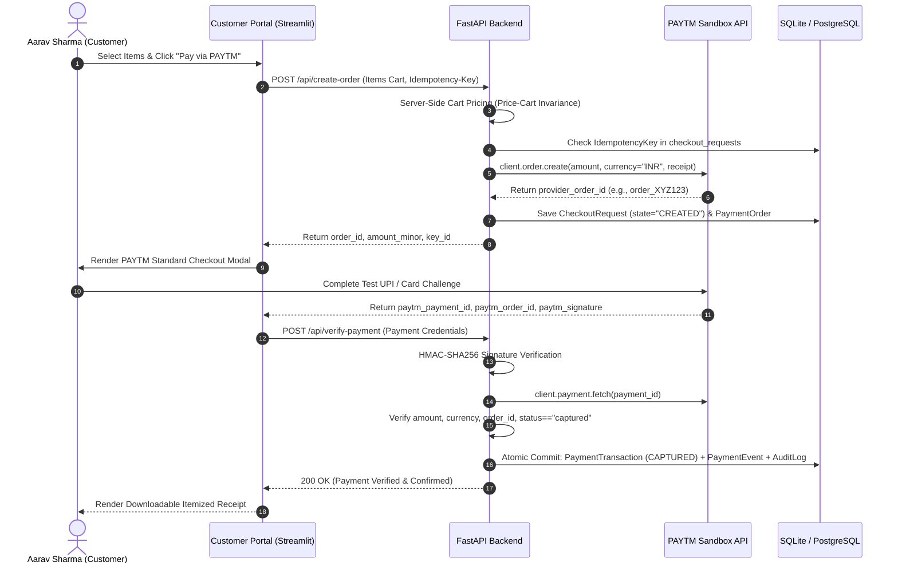
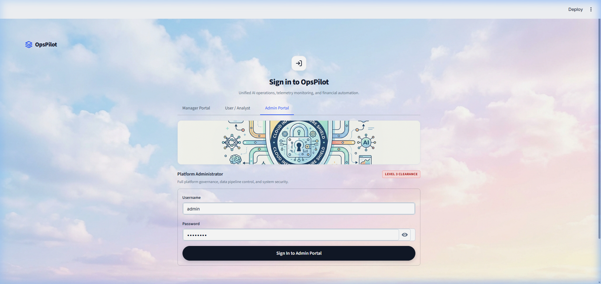
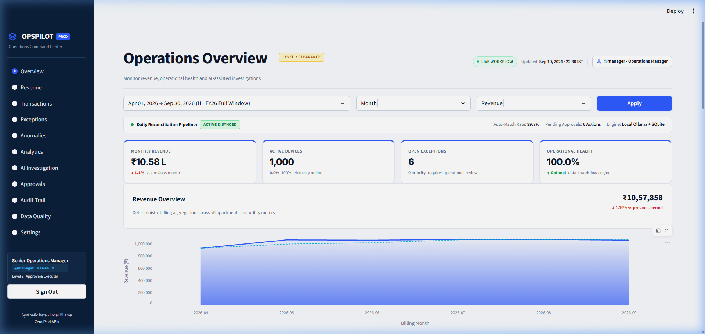
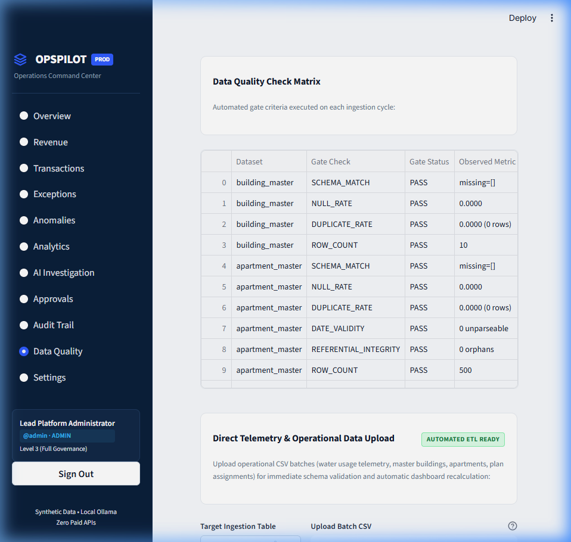
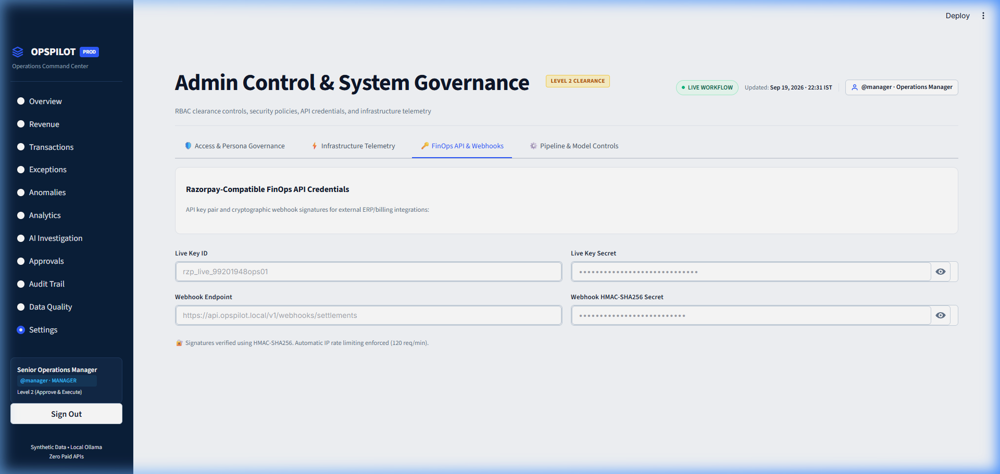
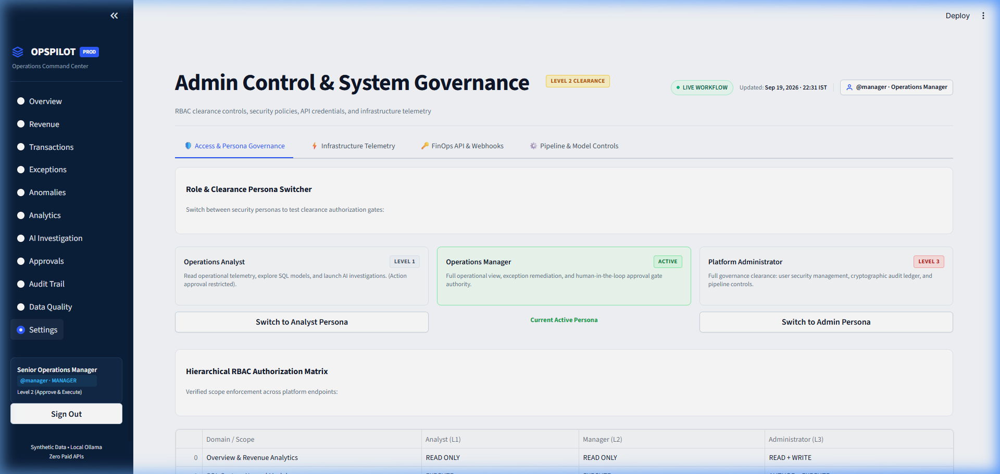
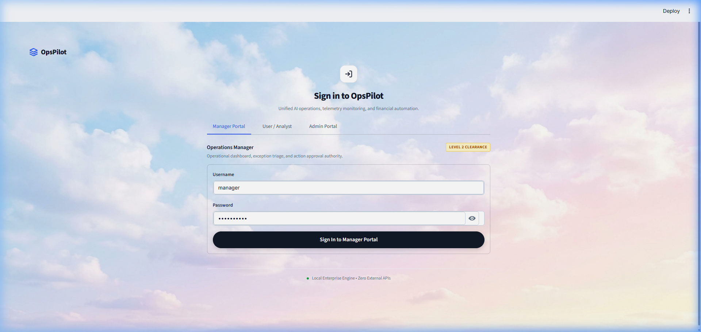

# PayBridge — AI-Powered FinOps & Payment Operations Platform

[](https://www.python.org/)
[](https://fastapi.tiangolo.com/)
[](https://streamlit.io/)
[](https://langchain-ai.github.io/langgraph/)
[](https://scikit-learn.org/)
[](https://www.sqlalchemy.org/)
[](https://ollama.ai/)
[](docs/LICENSE)

> **Autonomous Investigation & Reconciliation Engine with StateGraph Orchestration, Hybrid ML Anomaly Detection, Sub-50ms SQL Evidence Extraction, and Deterministic Human-in-the-Loop Governance**

---

## Prototype Scope & Important Disclaimers

> [!IMPORTANT]
> **Demo Mode · Synthetic Financial Data · Simulated Operational Actions**
> 
> - **Synthetic Telemetry:** All 50,000+ transaction records, merchant balances, customer profiles, and failure patterns are synthetically generated for demonstration and benchmarking purposes. No real cardholder or customer PII exists within this repository.
> - **PAYTM Checkout Integration:** The checkout module connects to PAYTM's public sandbox/test-mode endpoints using developer credentials. No real-money settlement or banking interchange is executed.
> - **Operational Mitigations:** Operational responses (e.g., UPI switch failover, merchant fulfillment holds, routing downgrades) are logged and persisted as decision records in the database. Live core-banking routing or NPCI switch toggles are simulated.
> - **Local Inference:** All LLM inference executes locally via Ollama (`qwen2.5:3b-instruct` / `nomic-embed-text`) or graceful deterministic fallbacks. Zero proprietary or paid third-party AI APIs are called.
> - **Database Support:** Verified and pre-packaged for zero-setup execution using **SQLite**. Production PostgreSQL drivers and Alembic migrations are implemented and included in the codebase.
> - **Independence:** PayBridge is an independent FinTech research prototype and engineering project. It is not affiliated with, endorsed by, or an official product of One97 Communications / Paytm.

---

## Contents

- [1. Executive Overview](#1-executive-overview)
- [2. The Problem & Operational Context](#2-the-problem-operational-context)
- [3. Key Platform Capabilities](#3-key-platform-capabilities)
- [4. System Architecture](#4-system-architecture)
  - [Architecture Topology](#architecture-topology)
  - [Core Security Model & Authority Boundaries](#core-security-model-authority-boundaries)
  - [End-to-End Component Flow](#end-to-end-component-flow)
- [5. Technology Stack](#5-technology-stack)
- [6. Data Sources & Synthetic Datasets](#6-data-sources-synthetic-datasets)
- [7. Data Ingestion & Data Quality Pipeline](#7-data-ingestion-data-quality-pipeline)
  - [Multi-Format Normalization](#multi-format-normalization)
  - [Validation & Invariant Enforcement](#validation-invariant-enforcement)
  - [Data Lineage & Rejection Reporting](#data-lineage-rejection-reporting)
- [8. Machine Learning & Anomaly Detection Engine](#8-machine-learning-anomaly-detection-engine)
  - [Feature Engineering Pipeline](#feature-engineering-pipeline)
  - [Unsupervised Isolation Forest Modeling](#unsupervised-isolation-forest-modeling)
  - [Deterministic Severity Ladder](#deterministic-severity-ladder)
- [9. Agentic AI & StateGraph Orchestration](#9-agentic-ai-stategraph-orchestration)
  - [LangGraph Linear Workflow (10 Nodes)](#langgraph-linear-workflow-10-nodes)
  - [Allowlisted Tool Registry](#allowlisted-tool-registry)
  - [Evidence Triangulation & Sufficiency Verification](#evidence-triangulation-sufficiency-verification)
  - [Numeric Grounding & Hallucination Elimination](#numeric-grounding-hallucination-elimination)
- [10. RAG Pipeline & Policy Retrieval](#10-rag-pipeline-policy-retrieval)
  - [Numbered Section Chunking](#numbered-section-chunking)
  - [In-Process TF-IDF & Cosine Similarity Index](#in-process-tf-idf-cosine-similarity-index)
  - [Role-Based Clearance & Prompt Injection Stripping](#role-based-clearance-prompt-injection-stripping)
- [11. Payment Operations & FinOps Workflows](#11-payment-operations-finops-workflows)
  - [PAYTM Standard Checkout Lifecycle](#paytm-standard-checkout-lifecycle)
  - [Durable Idempotency & Order Reconciliation](#durable-idempotency-order-reconciliation)
  - [Simulated Operational Scenarios (Rameshwaram Cafe UPI Outage)](#simulated-operational-scenarios-rameshwaram-cafe-upi-outage)
- [12. Security, Governance & Audit Trail](#12-security-governance-audit-trail)
  - [Server-Side Role-Based Access Control (RBAC)](#server-side-role-based-access-control-rbac)
  - [Cryptographic Audit Logging & Action Idempotency](#cryptographic-audit-logging-action-idempotency)
- [13. REST API Reference](#13-rest-api-reference)
- [14. Frontend Architecture & Role Portals](#14-frontend-architecture-role-portals)
  - [Admin FinOps Command Center](#admin-finops-command-center)
  - [Merchant Portal (Rameshwaram Cafe)](#merchant-portal-rameshwaram-cafe)
  - [Customer Portal (Aarav Sharma)](#customer-portal-aarav-sharma)
- [15. Visual Tour & Screenshots](#15-visual-tour-screenshots)
- [16. Repository Structure](#16-repository-structure)
- [17. Local Development Setup](#17-local-development-setup)
- [18. Docker & Containerized Deployment](#18-docker-containerized-deployment)
- [19. Configuration & Environment Variables](#19-configuration-environment-variables)
- [20. Testing & Empirical Validation](#20-testing-empirical-validation)
- [21. Known Limitations](#21-known-limitations)
- [22. Future Roadmap](#22-future-roadmap)
- [23. Acknowledgements & References](#23-acknowledgements-references)

---

## 1. Executive Overview

**PayBridge** is an enterprise-grade payment operations (PayOps) and financial operations (FinOps) platform engineered to bridge the gap between low-level payment gateway telemetry and high-level incident response.

In high-throughput payment architectures, payment failure spikes (e.g., UPI switch degradations, card network timeouts, issuer-specific outages) often take 20–45 minutes for Level 1 support teams to identify, query, correlate against standard operating procedures (SOPs), and escalate. PayBridge automates this entire lifecycle:

```
Telemetry & CSV Feeds ──► Ingestion & Invariant Audit ──► Multi-Variate Anomaly Signals (Isolation Forest)
                                                                     │
  Human Review & Recorded Audit ◄── Grounded Recommendation ◄── LangGraph State Machine (SQL + RAG)
```

1. **Ingests & Normalizes:** Streams and validates multi-format payment transaction logs across UPI, Card, Netbanking, and Wallets with strict schema invariance checks.
2. **Proposes & Scores:** Extracts multi-variate statistical features across gateway, payment rail, and banking institutions, running scikit-learn `IsolationForest` to flag multivariate outliers.
3. **Triangulates & Investigates:** Dispatches a deterministic 10-node LangGraph agent that executes allowlisted SQL queries, runs trusted financial arithmetic, and retrieves operating procedures (SOPs).
4. **Verifies & Grounding-Checks:** Validates evidence sufficiency across 3 independent data streams and checks every output number against computed figures before presenting findings.
5. **Enforces Human Governance:** Halts at a structural approval gate, requiring cryptographic approval from authorized managers before any operational mitigation is logged.

---

## 2. The Problem & Operational Context

Payment aggregators and high-volume merchants operate in an environment of extreme operational fragmentation:

| Operational Challenge | Industry Reality | PayBridge Solution |
|---|---|---|
| **Alert Fatigue & Noise** | Raw threshold alerts trigger on minor statistical blips, flooding on-call engineers. | Hybrid ML + Rule engine: Isolation Forest proposes anomalies, but deterministic rules govern severity. Unsupervised signals alone are capped at `LOW`. |
| **Data Lineage Disconnect** | Dirty partner CSVs and dropped webhook events silently corrupt downstream ledgers. | Multi-synonym column mapper, strict type casting, duplicate rejection tracking, and per-row rejection audit logs. |
| **Hallucination in FinTech AI** | LLMs given free-form SQL or arithmetic invent non-existent numbers and execute unverified operations. | LLM is stripped of SQL and math authority. Named-query allowlists and deterministic Python arithmetic provide verified numbers. |
| **Unaccountable Action Execution** | Automated AI agents triggering production switchovers risk cascading outages. | Two-stage decoupled graph: the investigation graph terminates at `approval_gate`. Execution requires explicit human database approval. |
| **Audit & Compliance Deficits** | Ad-hoc Slack decisions and manual database scripts leave no immutable compliance trail. | Every tool invocation, SQL payload hash, latency metric, and approval signature is captured in structured `audit_logs`. |

---

## 3. Key Platform Capabilities

- **Unified 3-Role Architecture:** Cleanly segregated presentation and business logic for **Platform Admin** (FinOps Command Hub), **Merchant Store** (Rameshwaram Cafe), and **Customer** (Aarav Sharma).
- **PAYTM Standard Web Checkout:** Idempotent order creation (`POST /api/create-order`) and server-side HMAC-SHA256 signature and provider-state verification (`POST /api/verify-payment`).
- **High-Throughput Batch Ingestion:** Memory-efficient chunked CSV parser handling 50,000+ transaction batches in under 55 seconds with deduplication and rejected-row lineage.
- **Multi-Variate ML Anomaly Detector:** Scikit-learn `IsolationForest(n_estimators=100, contamination=0.08)` calculating multi-dimensional outlier scores over gateway-method-bank aggregations.
- **Deterministic 10-Node LangGraph State Machine:** Linear graph orchestrating alert intake, query planning, SQL execution, RAG retrieval, numeric grounding, and approval gating.
- **Safe SQL Analytics (22 Allowlisted Queries):** Complete catalog of CTE-driven, window-partitioned SQL queries for GMV, retry effectiveness, bank switch health, and merchant SLA adherence.
- **RAG Policy Engine:** In-process TF-IDF vectorizer indexing 9 internal SOP documents (51 chunks) with role-based access filtering and automated prompt injection redaction.
- **Local LLM Inference:** Powered entirely by local Ollama (`qwen2.5:3b-instruct` / `nomic-embed-text`) with instant, zero-downtime deterministic fallbacks when Ollama is offline.
- **Human-in-the-Loop Approvals:** Non-bypassable database approval gate enforcing dual-control authorization on sensitive mitigation actions.

---

## 4. System Architecture

### Architecture Topology



### Core Security Model & Authority Boundaries

The cardinal rule of the PayBridge architecture is: **The Language Model has the least authority of any component in the system.**

| Capability | Held By | Verification & Safety Mechanism |
|---|---|---|
| **Write SQL** | Application Only | LLM selects an allowlisted query name from `QUERIES`; it cannot construct or modify SQL text. |
| **Choose Tools** | Deterministic Planner | Node sequence is fixed by a state machine; prompt injections cannot hijack tool selection. |
| **Perform Math** | Python Runtime | Monetary sums, MDR fees, GST taxes, and error rates use exact Decimal arithmetic. |
| **Assign Severity** | Deterministic Rules | `CRITICAL`, `HIGH`, `MEDIUM`, `LOW` tiers are assigned by mathematical rules, never model sentiment. |
| **Execute Actions** | Authorized Human Only | Graph halts before execution; resuming requires a persisted `APPROVED` database record. |
| **Generate Prose** | **Local LLM** | Explains facts and inferences, subject to strict numeric grounding checks. |

### End-to-End Component Flow



---

## 5. Technology Stack

### Backend Infrastructure
- **Framework:** FastAPI 0.110 (ASGI, Pydantic v2 schemas, Dependency Injection)
- **Application Server:** Uvicorn 0.27 (Standard worker configuration)
- **Language:** Python 3.11+
- **ORM & Database:** SQLAlchemy 2.0 with connection pooling; SQLite (zero-setup demo) and PostgreSQL driver (`psycopg2-binary 2.9`)
- **Database Migrations:** Alembic 1.13 tracking 13 core domain tables and 7 operational tables
- **Security & Tokens:** PyJWT 2.8 (HS256 signature verification), stdlib `hashlib.pbkdf2_hmac` (200,000 iterations, 16-byte cryptographically secure salt)

### Data Engineering & Analytics
- **Data Manipulation:** pandas 2.0, NumPy 1.24
- **Spreadsheet & Bulk Processing:** openpyxl 3.1, chunked streaming CSV reader
- **Analytical SQL:** 22 named allowlisted queries leveraging CTEs, `LAG()`, `ROW_NUMBER()`, and rolling windows

### Machine Learning & Agentic AI
- **Anomaly Detection:** scikit-learn 1.3 `IsolationForest` (multi-variate outlier scoring)
- **Agent Orchestration:** LangGraph 0.2 (StateGraph state machine with deterministic routing)
- **Information Retrieval (RAG):** In-process `TfidfVectorizer` with cosine similarity; optional local embeddings via `nomic-embed-text`
- **Local Inference:** Ollama client with streaming timeout handling (`qwen2.5:3b-instruct`)

### Frontend & Visual System
- **Web UI:** Streamlit 1.30 (Multi-role reactive workspace)
- **Design System:** Custom FinTech CSS (`PAYTM_THEME_CSS`) inspired by modern Indian payment portals (Inter typography, JetBrains Mono numbers, high-contrast status pills)
- **Payment Modal:** Custom HTML5/JS iframe bridge for PAYTM standard checkout integration

### Code Quality & Testing
- **Test Framework:** pytest 7.4, pytest-cov 4.1, HTTPX 0.26
- **Static Analysis:** Ruff 0.12 (linter and formatter), Mypy 1.9 (strict type checking)

---

## 6. Data Sources & Synthetic Datasets

PayBridge operates entirely on realistic, synthetically generated payment telemetry representing typical Indian digital commerce rails:

```
backend/data/
├── payment_data.db                 # Packaged SQLite database containing 50,000 transactions
├── raw/
│   ├── payment_platform_50000_transactions.csv  # 50k transaction raw CSV (8.3 MB)
│   ├── fintech_merchants.csv                    # 10 Indian retail/food/SaaS merchants
│   ├── fintech_customers_500plus.csv            # 25,000 synthetic buyer profiles
│   ├── sample_incoming_payments.csv             # Ingestion test batch
│   └── ingestion_archive/                       # Lineage archive of accepted raw imports
├── rejected/                                    # Quarantined CSV files with explicit failure reasons
└── documents/                                   # Knowledge base SOP documents (RAG corpus)
    ├── SOP-001_upi_switch_degradation.txt
    ├── SOP-002_fulfillment_hold_policy.txt
    ├── SOP-003_reconciliation_discrepancy.txt
    ├── SOP-004_payment_dispute_sla.txt
    ├── DOC-001_revenue_calculation_sop.txt
    ├── DOC-002_plan_validation_policy.txt
    ├── DOC-003_data_quality_sop.txt
    ├── DOC-004_privacy_policy.txt
    └── DOC-005_exception_escalation_sop.txt
```

### Seeded Platform Merchants

| Merchant ID | Trade Name | Category | Default Rails | Settlement Cycle | Risk Tier |
|---|---|---|---|---|---|
| `mid_rameshwaram_01` | Rameshwaram Cafe | Food & Beverage | UPI, Cards, Netbanking | T+1 | LOW |
| `mid_swiggy_01` | Swiggy Instant Logistics | Food Delivery | UPI, Cards, Netbanking | T+1 | LOW |
| `mid_flipkart_01` | Flipkart Commerce | E-Commerce | UPI, Cards, Wallets | T+2 | LOW |
| `mid_zomato_01` | Zomato Media | Food Delivery | UPI, Cards, Wallets | T+1 | LOW |
| `mid_zepto_01` | Zepto 10-Min Grocery | Quick Commerce | UPI, Cards | T+1 | LOW |
| `mid_bookmyshow_01`| BookMyShow Entertainment| Ticketing | Cards, UPI, Netbanking | T+1 | MEDIUM |
| `mid_ola_01` | ANI Technologies (Ola) | Ride Hailing | Wallets, UPI, Cards | T+1 | MEDIUM |
| `mid_uber_01` | Uber India Systems | Ride Hailing | Cards, UPI | T+1 | LOW |
| `mid_makemytrip_01`| MakeMyTrip India | Online Travel | Cards, Netbanking, UPI | T+2 | MEDIUM |
| `mid_nykaa_01` | FSN E-Commerce (Nykaa) | Beauty & Retail | UPI, Cards | T+1 | LOW |

---

## 7. Data Ingestion & Data Quality Pipeline

```
Raw CSV / Webhook ──► Header Synonym Mapping ──► Canonical Normalization ──► 10 Invariant Checks
                                                                                     │
              Database Persistence ◄── Accepted Rows ◄── Deduplication Check ◄───────┴──► Rejected CSV Archive
```

### Multi-Format Normalization

The ingestion engine (`app/services/ingestion_payments.py`) accepts heterogeneous payment CSVs from diverse aggregators, automatically mapping irregular column names to canonical schema keys:

```python
CANONICAL_COLUMN_SYNONYMS = {
    "payment_id":  ["payment_id", "transaction_id", "txn_id", "payment_reference", "id", "pay_id"],
    "amount":      ["amount", "txn_amount", "gross_amount", "total_amount", "value", "price"],
    "currency":    ["currency", "curr", "currency_code"],
    "method":      ["method", "payment_method", "rail", "payment_mode", "mode", "payment_type"],
    "status":      ["status", "payment_status", "txn_status", "transaction_status", "state"],
    "merchant_id": ["merchant_id", "mid", "seller_id", "store_id", "partner_id"],
    "customer_id": ["customer_id", "cust_id", "buyer_id", "user_id", "client_id"],
    "bank":        ["bank", "issuing_bank", "bank_name", "bank_code", "issuer"],
    "gateway":     ["gateway", "pg", "aggregator", "gateway_name", "processor"],
    "timestamp":   ["timestamp", "created_at", "transaction_timestamp", "txn_time", "date"],
    "order_id":    ["order_id", "order_ref", "receipt", "order_number"]
}
```

Categorical values are normalized using canonical dictionaries:
- **Methods:** `googlepay`, `phonepe`, `paytm` $\rightarrow$ `UPI`; `credit_card`, `cc` $\rightarrow$ `CARD`; `internet_banking` $\rightarrow$ `NETBANKING`
- **Statuses:** `success`, `paid` $\rightarrow$ `CAPTURED`; `declined`, `error` $\rightarrow$ `FAILED`; `initiated` $\rightarrow$ `PENDING`
- **Banks:** `state bank of india` $\rightarrow$ `SBI`; `hdfc bank` $\rightarrow$ `HDFC`; `icici bank` $\rightarrow$ `ICICI`

### Validation & Invariant Enforcement

Every imported row is validated against strict financial and structural invariants:
1. `SCHEMA_MATCH`: Mandatory headers must be present and mappable.
2. `NULL_RATE`: Critical columns (`payment_id`, `amount`, `status`, `merchant_id`) must not be empty.
3. `VALUE_RANGE`: Amounts must satisfy $1.00 \le \text{amount} \le 1,000,000.00$ INR. Negative or zero values are immediately rejected.
4. `CURRENCY_CHECK`: Currency must be exactly `INR`. Multi-currency settlements are rejected in this edition.
5. `DATE_VALIDITY`: Timestamps must parse to valid ISO datetime formats and cannot exist in the future.
6. `REFERENTIAL_INTEGRITY`: `merchant_id` must resolve to an active merchant record in the database.
7. `DUPLICATE_RATE`: Duplicate `payment_id` occurrences within the file or existing database are flagged and rejected to preserve ledger invariance.

### Data Lineage & Rejection Reporting

- **Accepted Rows:** Committed atomically to `payment_transactions` and `payment_orders`.
- **Lineage Run Record:** Logged in `payment_ingestion_runs` with `records_received`, `records_accepted`, `records_rejected`, `records_duplicated`, duration, and file paths.
- **Rejected Row Audit:** Every failed row is written to `payment_ingestion_records` with exact row number, raw input payload JSON, and the explicit rejection reason.
- **Physical Isolation:** Original inputs are moved to `backend/data/raw/ingestion_archive/` and rejection summaries are written to `backend/data/rejected/rejected_<run_id>.csv`.

---

## 8. Machine Learning & Anomaly Detection Engine

PayBridge utilizes a **hybrid anomaly detection architecture**: Unsupervised machine learning proposes multivariate outliers, while deterministic financial rules govern severity and alerting.

```
Payment Transactions ──► Feature Extraction (SQL) ──► IsolationForest (Contamination=0.08)
                                                               │
                                               Proposes Outlier Score [-1, 1]
                                                               │
     Persisted Alert (MEDIUM+) ◄── Severity Ladder (Rule-Governed) ◄── ML-Only Capped at LOW
```

### Feature Engineering Pipeline

The feature engineering layer executes a high-performance aggregation query over `payment_transactions`, grouping by `(gateway, method, bank)`:

$$\mathbf{x} = \begin{bmatrix} \text{total\_attempts} \\ \text{failed\_count} \\ \text{failure\_rate\_pct} \\ \text{total\_volume\_inr} \\ \text{retryable\_failures} \end{bmatrix}$$

Derived mathematical ratios include:
- **Terminal Success Rate:** $\text{SR}_{\%} = \frac{\text{captured\_count}}{\text{captured\_count} + \text{failed\_count}} \times 100$ (Pending authorizations are excluded from the denominator to avoid skewing real-time rates).
- **Terminal Failure Rate:** $\text{FR}_{\%} = 100.0 - \text{SR}_{\%}$
- **Retryable Failure Ratio:** $\frac{\text{retryable\_failures}}{\text{failed\_count}}$ where retryable codes include `BAD_REQUEST_GATEWAY_DOWN`, `GATEWAY_TIMEOUT`, and `BANK_DEBITED_PAYMENT_PENDING`.

### Unsupervised Isolation Forest Modeling

- **Algorithm:** Scikit-Learn `IsolationForest(n_estimators=100, contamination=0.08, random_state=42)`
- **Contamination Factor:** Capped at $\min(\text{contamination}, 0.49)$ to ensure mathematical stability on small feature matrices.
- **Anomaly Scoring:** Anomaly score is computed as $\text{score} = -s(\mathbf{x})$, where higher values indicate stronger deviation from baseline feature density. A binary outlier flag is produced: $-1$ (outlier) or $+1$ (inlier).

### Deterministic Severity Ladder

To guarantee reproducibility and prevent unpredictable LLM escalations, severity is strictly rule-governed:

| Condition / Threshold | Assigned Severity | Operational Hypothesis | Standard Action |
|---|---|---|---|
| UPI Failure Rate $\ge 35\%$ ($\ge 5$ attempts) | **CRITICAL** | NPCI switch timeout / UPI switch collapse | SOP-001: Route traffic to secondary UPI switch |
| UPI Failure Rate $\ge 20\%$ ($\ge 5$ attempts) | **HIGH** | Core banking switch degradation | SOP-001: Suppress checkout retries |
| Bank Failure Rate $\ge 40\%$ ($\ge 5$ attempts) | **CRITICAL** | Core banking switch outage at specific bank | SOP-001: Downgrade bank traffic & show downtime banner |
| Bank Failure Rate $\ge 25\%$ ($\ge 5$ attempts) | **HIGH** | Intermittent issuer connection drops | SOP-001: Post banner warning on checkout modal |
| Channel Failure Rate $\ge 30\%$ ($\ge 10$ attempts) | **HIGH** | Card network authentication timeout | Investigate gateway error codes |
| Channel Failure Rate $\ge 20\%$ ($\ge 10$ attempts) | **MEDIUM** | Network route degradation | Verify payment gateway health status |
| Retryable Timeouts $\ge 15$ | **HIGH** | Aggregator queue backlog | SOP-002: Place merchant fulfillment on 30-min hold |
| Retryable Timeouts $\ge 5$ | **MEDIUM** | Transient network timeout | SOP-002: Monitor double-debit queue |
| **ML-Only Detection (No Rule Breach)** | **LOW (Capped)** | Multivariate statistical drift | Log for review; **prohibited from creating alerts** |

> [!TIP]
> **Why ML-only detections are capped at LOW:** An unsupervised statistical outlier is an invitation to investigate, not grounds to awaken an on-call engineer or trigger bank switchovers.

---

## 9. Agentic AI & StateGraph Orchestration

### LangGraph Linear Workflow (10 Nodes)

PayBridge models an operational investigation as a single, deterministic state machine built on **LangGraph**. There is no multi-agent chatter or open-ended autonomy:

```
[1. intake] ──► [2. planner] ──► [3. sql_investigator] ──► [4. retrieval_investigator]
                                                                   │
[STOP] ◄── [8. approval_gate] ◄── [7. recommendation_gen] ◄── [6. evidence_validator] ◄── [5. analytics_inv]
   │
   └─► (Separate Resumption Graph via POST /workflows/{id}/approve)
         └─► [9. action_executor] ──► [10. audit_logger]
```

| Node # | Node Identifier | Operational Responsibility | Uses LLM? |
|---|---|---|---|
| **1** | `intake` | Loads alert from DB; validates schema; builds question. Fails safe if missing. | No |
| **2** | `planner` | Determines exact sequence of SQL queries and SOP documents required. | **No (Deterministic)** |
| **3** | `sql_investigator` | Executes allowlisted SQL queries with bound parameters against the database. | No |
| **4** | `retrieval_investigator` | Queries RAG vector store for operational policies; scans for injection. | No |
| **5** | `analytics_investigator` | Computes exact financial ratios and loss exposure using Python Decimal. | No |
| **6** | `evidence_validator` | Verifies sufficiency: requires $\ge 2$ data streams and a valid baseline. | No |
| **7** | `recommendation_generator`| Synthesizes narrative; executes numeric grounding check on generated text. | **Yes (Ollama / Fallback)** |
| **8** | `approval_gate` | Persists workflow state and creates a `PENDING` approval database row. | No |
| **9** | `action_executor` | Re-reads DB approval row (dual-check); executes approved mitigation. | No |
| **10** | `audit_logger` | Computes SHA-256 payload hashes; writes complete trace to `audit_logs`. | No |

### Allowlisted Tool Registry

To prevent arbitrary code execution and SQL injection, the agent can only invoke tools from a strictly allowlisted registry:

```python
ACTION_REGISTRY = {
    "create_incident":   create_incident,    # Creates incident tracking record
    "create_ticket":     create_ticket,      # Opens Jira/ServiceNow engineering ticket
    "send_notification": send_notification,  # Dispatches Slack/email alert to on-call
    "no_action":         no_action,          # Closes alert as transient variance
}

SENSITIVE_ACTIONS = {"create_incident", "create_ticket"}  # Requires human approval
```

### Evidence Triangulation & Sufficiency Verification

Before a recommendation is generated, `evidence_validator` evaluates evidence quality across three independent streams:
1. **ANALYTICS Stream:** Computed failure rates, GMV impact, and attempt counts.
2. **SQL Stream:** Allowlisted query results detailing bank and method breakdowns.
3. **POLICY Stream:** Retrieved operating procedure sections and SLAs.

If fewer than 2 streams are present, or if no historical baseline exists for comparison, the workflow halts and issues an **`INSUFFICIENT_EVIDENCE`** verdict, refusing to speculate on root cause.

### Numeric Grounding & Hallucination Elimination

After generation, `check_grounding()` parses every integer and floating-point number in the LLM's response using regex. Each extracted number is checked against the set of numbers actually computed in the evidence bundle.

- If an unverified number is detected (e.g., an invented loss figure like `₹999,999.00`):
  1. The figure is appended to `uncertainty` as `[UNVERIFIED FIGURES: 999999.00]`.
  2. The recommendation confidence is automatically downgraded to **`LOW`**.
  3. The audit log flags `grounding_breach = True`.

---

## 10. RAG Pipeline & Policy Retrieval

PayBridge integrates a localized, private Retrieval-Augmented Generation (RAG) subsystem designed specifically for operational runbooks and standard operating procedures (SOPs).

### Numbered Section Chunking

Policy documents are structured rulebooks. Standard sliding-window chunking breaks semantic cohesion. PayBridge uses **deterministic heading-based splitting**:
- Documents are split along regex boundaries matching `\n(?=\d+\.\s+[A-Z])`.
- Each chunk represents an entire, self-contained numbered rule (e.g., `SOP-001 §3: Traffic Routing Protocols`).
- Every chunk carries rich metadata: `document_id`, `version`, `effective_date`, `access_level`, `section`, and formatted `citation` string (e.g., `[SOP-001 v2.0 §3] UPI Switch Failover Protocol`).

### In-Process TF-IDF & Cosine Similarity Index

The default vector store is an in-process, disk-persisted `TfidfVectorizer` paired with `cosine_similarity`. 
- **Rationale:** The policy corpus consists of 9 documents and 51 chunks. Running heavy external vector databases (ChromaDB, Pinecone, Milvus) introduces network overhead and RAM footprint that competes with local LLM VRAM on developer workstations.
- **Accuracy:** Evaluated at **Recall@4 = 1.000** and **Top-1 Accuracy = 0.955** across 22 benchmark operational questions.
- **Dense Option:** Switching `EMBEDDING_MODE=ollama` transparently upgrades the vectorizer to local `nomic-embed-text` embeddings.

### Role-Based Clearance & Prompt Injection Stripping

1. **Clearance Filtering:** Chunks carry access levels (`PUBLIC`, `INTERNAL`, `RESTRICTED`). An analyst session is mathematically restricted from retrieving `RESTRICTED` executive compensation or fraud mitigation policies.
2. **Prompt Injection Redaction:** Retrieved text is scanned against 9 regex patterns matching instruction overrides (e.g., `ignore previous instructions`, `system prompt override`, `grant admin access`). Any matching chunk is purged and replaced with `[CONTENT REDACTED: SUSPECTED PROMPT INJECTION]` *before* context assembly.

---

## 11. Payment Operations & FinOps Workflows

### PAYTM Standard Checkout Lifecycle



### Durable Idempotency & Order Reconciliation

- **Checkout Reservation:** Every checkout attempt writes a row to `checkout_requests` with state `PROCESSING` and a SHA-256 fingerprint of `(customer_id, merchant_id, items, amount, currency)`.
- **Duplicate Prevention:** A client retry with the same `Idempotency-Key` returns the existing provider order without creating a duplicate order with the gateway.
- **Server-Side Pricing:** Amounts submitted by the client are discarded. The server prices the cart using internal price tables to eliminate client-side price tampering.
- **Checkout Reconciliation:** `app/services/checkout_reconciliation.py` recovers orphan provider orders if a browser crash or network break occurs between gateway capture and database persistence.

### Simulated Operational Scenarios (Rameshwaram Cafe UPI Outage)

The platform includes pre-configured operational scenarios demonstrating real-world payment failure investigations:

```
Incident Profile: RAMESHWARAM CAFE — UPI / SBI SWITCH OUTAGE
--------------------------------------------------------------------------------
Entity:              Merchant: mid_rameshwaram_01 | Gateway: PAYTM_DIRECT
Failure Signature:   503 Captured · 133 Failed · 4 Pending
Terminal Failure %:  133 / (503 + 133) = 20.91% Failure Rate
Financial Exposure:  INR 41,360.00 in attempted failed transactions
Primary Error Code:  BAD_REQUEST_GATEWAY_DOWN / GATEWAY_TIMEOUT
Operational SOP:     SOP-001 (UPI Switch Degradation & Traffic Shift)
Recommended Action:  1. Temporarily downgrade SBI UPI switch routing weight
                     2. Display "SBI UPI Network Slow" banner in checkout modal
                     3. Enforce 30-minute fulfillment hold (SOP-002)
```

---

## 12. Security, Governance & Audit Trail

### Server-Side Role-Based Access Control (RBAC)

Authentication uses PBKDF2-HMAC-SHA256 password hashing with unique 16-byte cryptographic salts. Authorization is enforced strictly on the server via FastAPI dependencies (`require("permission_name")`):

| Role | Clearance Level | Granted Permissions | Forbidden Operations |
|---|---|---|---|
| **Analyst** | `INTERNAL` | `view`, `investigate` | Cannot approve or reject mitigations; cannot configure thresholds. |
| **Manager** | `INTERNAL` | `view`, `investigate`, `approve`, `reject` | Cannot alter user access or security policies. |
| **Admin** | `RESTRICTED` | `view`, `investigate`, `approve`, `reject`, `configure`, `administer` | Full operational and governance authority. |

> [!CAUTION]
> UI role switching in Streamlit is a **presentation feature** for demo convenience. In production mode (`DEMO_MODE=false`), the backend strictly mandates signed JWT bearer tokens on all endpoints.

### Cryptographic Audit Logging & Action Idempotency

- **Audit Trails:** Every agent execution, SQL query, RAG retrieval, and approval event writes to `audit_logs` containing `audit_id`, `workflow_id`, `agent_node`, `tool_name`, `input_hash` (SHA-256 of parameters), `result_status`, `latency_ms`, and `timestamp`.
- **Action Idempotency:** Sensitive actions calculate a unique key:
  $$\text{IdempotencyKey} = \text{SHA-256}(\text{workflow\_id} \mathbin{\Vert} \text{action\_type} \mathbin{\Vert} \text{payload})$$
  Enforced by a database unique constraint. Repeated approvals result in `DUPLICATE_SKIPPED` rather than multiple operational triggers.

---

## 13. REST API Reference

The FastAPI gateway exposes a fully interactive Swagger UI at `http://127.0.0.1:8000/docs`.

| Method | Endpoint | Description | Auth / Role |
|---|---|---|---|
| `GET` | `/health` | Service health status, database ping, Ollama status | Public |
| `POST` | `/auth/login` | Authenticate with username/password; returns JWT | Public |
| `GET` | `/auth/me` | Retrieve current authenticated user profile and permissions | Bearer Token |
| `GET` | `/alerts` | List detected payment and operational alerts | Analyst+ |
| `GET` | `/alerts/{alert_id}` | Fetch full details for a specific alert | Analyst+ |
| `POST` | `/alerts/{alert_id}/investigate` | Launch 10-node LangGraph investigation workflow | Analyst+ |
| `GET` | `/workflows/{workflow_id}` | Retrieve state, evidence, and recommendations for a workflow | Analyst+ |
| `POST` | `/workflows/{workflow_id}/approve` | Approve a pending operational action | Manager / Admin |
| `POST` | `/workflows/{workflow_id}/reject` | Reject a pending operational action with reason | Manager / Admin |
| `GET` | `/api/v1/payments/kpis` | Summary KPIs (attempts, captured, failed, SR%, GMV) | Analyst+ |
| `GET` | `/api/v1/payments/dashboard` | Multi-dimensional payment analytics slicing | Analyst+ |
| `POST` | `/api/create-order` | Create server-priced PAYTM test checkout order | Customer Checkout |
| `POST` | `/api/verify-payment` | Verify HMAC signature & provider state for capture | Customer Checkout |
| `POST` | `/api/v1/ingestion/csv` | Upload and validate payment CSV file batch | Manager+ |
| `GET` | `/api/v1/ingestion/runs` | List history and status of batch ingestion runs | Analyst+ |
| `POST` | `/api/v1/ingestion/url` | Ingest external payment CSV via validated URL | Manager+ |
| `GET` | `/api/v1/events` | Stream raw immutable payment transition events | Analyst+ |
| `GET` | `/anomalies` | List detected multi-variate anomalies | Analyst+ |
| `GET` | `/audit` | Query cryptographic audit logs with SHA-256 hashes | Admin Only |
| `GET` | `/metrics` | Prometheus-style system operational metrics | Admin Only |
| `GET` | `/evaluation` | Retrieve automated RAG and agent safety benchmark scores| Admin Only |

---

## 14. Frontend Architecture & Role Portals

The Streamlit frontend (`frontend/dashboard.py`) delivers three specialized role workspaces:

### Admin FinOps Command Center
- **Overview:** Executive KPI ribbon (Attempts, Captured GMV, Terminal Failure Rate, MDR Fees), volume sparklines, and filterable transaction ledgers.
- **Payments:** Comprehensive search with pagination (100 rows/page) and date-range filters supporting 50,000+ stored rows.
- **Anomalies:** Real-time Isolation Forest proposals and rule-triggered alert feeds.
- **AI Investigation:** Interactive LangGraph workspace with one-click investigation execution, structured evidence breakdown, and deterministic support query lookup.
- **Data Pipeline:** Drag-and-drop CSV upload with real-time validation counts, accepted preview, and rejected row breakdown.
- **Approvals:** Dual-control approval inbox with audit logs and simulated operational dispatch.
- **Audit:** Searchable ledger of every automated and human decision with SHA-256 payload hashes.

### Merchant Portal (Rameshwaram Cafe)
- **Live Store Ledger:** Real-time customer orders, cooking status indicators, and gross receipts.
- **Payment Performance:** Success rate breakdowns across UPI, Card, and Netbanking.
- **Fulfillment Advisories:** Clear alerts indicating when customer fulfillment should be placed on temporary hold due to bank switch timeouts.

### Customer Portal (Aarav Sharma)
- **Interactive Menu:** 5-item South Indian cafe menu with custom quantity selectors and preset combo buttons (Breakfast ₹280, Snack ₹150).
- **Payment Methods:** Integrated PAYTM checkout modal alongside an instant simulated demo wallet with ₹50,000 credit.
- **Transparent Ledger:** Instant receipt generation with downloadable purchase orders, itemized tax breakdowns, and double-debit protection status.

---

## 15. Visual Tour & Screenshots

| Platform Feature | Visual Artifact | Description |
|---|---|---|
| **FinOps Command Hub** |  | Unified executive view displaying real-time payment KPIs, captured volume, and alert feeds. |
| **Operations Overview** |  | High-level operations overview tracking payment methods, terminal success rates, and bank health. |
| **Data Ingestion Pipeline** |  | CSV upload interface displaying received, accepted, and rejected row counts with lineage tracking. |
| **API & Webhook Engine** |  | Interactive FastAPI OpenAPI documentation displaying endpoint contracts and schemas. |
| **Governance & Settings** |  | Platform governance dashboard showing access control, customer policies, and database status. |
| **Role Authentication** |  | Secure login portal supporting Analyst, Manager, and Admin role credentials. |

---

## 16. Repository Structure

```
PayBridge/
├── .github/workflows/ci.yml        # CI test pipeline (Python 3.11/3.12, Ruff, Mypy)
├── .env.example                    # Environment variable template
├── Dockerfile                      # Production container specification
├── docker-compose.yml              # Local multi-service orchestration (API + UI + Postgres)
├── requirements.txt                # Production Python dependencies
├── start-demo.ps1                  # Single-command local Windows launcher
├── build-submission.py             # Packaging and distribution verification script
├── SUBMISSION.md                   # Hackathon presentation script & demo runbook
├── VALIDATION.md                   # Empirical validation evidence and test logs
│
├── backend/
│   ├── alembic/                    # Database migration scripts
│   ├── alembic.ini                 # Migration configuration
│   ├── main.py                     # Root ASGI entrypoint
│   ├── pyproject.toml              # Build metadata and tool configuration
│   ├── scripts/
│   │   ├── setup_all.py            # Complete bootstrap (Ingest 50k + Anomaly + RAG)
│   │   ├── setup_demo.py           # Fast demo setup script
│   │   ├── run_rag_eval.py         # 22-case RAG evaluation harness
│   │   └── run_agent_eval.py       # 35-case Agent security evaluation harness
│   │
│   ├── data/
│   │   ├── payment_data.db         # Packaged SQLite database (50k transactions)
│   │   ├── raw/                    # Raw synthetic datasets and lineage archive
│   │   ├── rejected/               # Quarantined CSV rejection logs
│   │   └── documents/              # Knowledge base SOP documents (9 files)
│   │
│   └── app/
│       ├── api/                    # FastAPI routes (checkout.py, main.py)
│       ├── agent/                  # LangGraph state machine & evidence validation
│       │   ├── workflow.py         # 10-node StateGraph definition
│       │   ├── evidence.py         # Numeric grounding & evidence sufficiency checks
│       │   └── tools/              # Allowlisted tools (sql, rag, analytics, action)
│       ├── analytics/              # Payment analytics engine & 22 named SQL queries
│       ├── core/                   # Security, PBKDF2 hashing, JWT, config, rate limiting
│       ├── db/                     # SQLAlchemy engine, session maker, base models
│       ├── ml/                     # Isolation Forest & deterministic severity rules
│       ├── models/                 # SQLAlchemy schemas (payments.py, ops.py, core.py)
│       ├── rag/                    # TF-IDF store, chunker, and Ollama integration
│       └── services/               # Ingestion, validation, cafe menu, data generator
│
├── frontend/
│   ├── app.py                      # Streamlit application entrypoint
│   ├── dashboard.py                # Multi-role navigation hub
│   ├── styles.py                   # FinTech CSS design system
│   ├── components.py               # Reusable UI widgets and KPI cards
│   ├── payment_checkout/           # PAYTM JS payment modal bridge
│   └── views/                      # Role views (admin, merchant, customer, etc.)
│
├── screenshots/                    # Genuine UI and architecture visual assets
└── docs/                           # Exhaustive technical documentation & runbooks
    ├── architecture.md             # System layers and authority boundaries
    ├── agent-design.md             # LangGraph state machine specification
    ├── data-pipeline.md            # Data engineering and validation rules
    ├── ml-anomaly-detection.md     # Hybrid ML and severity ladder design
    ├── rag.md                      # RAG retrieval and chunking architecture
    ├── security.md                 # RBAC, prompt injection, and SQL safety
    ├── sql-analytics.md            # Allowlisted SQL query rationale
    ├── testing.md                  # Test suites and edge-case coverage
    └── decision-log.md             # Architectural decision records (ADRs)
```

---

## 17. Local Development Setup

### Prerequisites
- **Python:** Version 3.11 or 3.12 (64-bit recommended)
- **Operating System:** Windows, macOS, or Linux
- **Ollama (Optional for Live AI):** Download and run [Ollama](https://ollama.ai/). Pull the model:
  ```bash
  ollama pull qwen2.5:3b-instruct
  ```
  *(Note: If Ollama is not installed, PayBridge automatically runs its built-in deterministic fallback engine without error).*

### Step-by-Step Installation

1. **Clone the Repository:**
   ```bash
   git clone https://github.com/naveenkotnana/PayBridge-Payments-AI-Powered-FinOps-Payment-Operations-Platform.git
   cd PayBridge-Payments-AI-Powered-FinOps-Payment-Operations-Platform
   ```

2. **Create and Activate a Virtual Environment:**
   ```bash
   # Windows (PowerShell)
   python -m venv venv
   .\venv\Scripts\Activate.ps1

   # Linux / macOS
   python3 -m venv venv
   source venv/bin/activate
   ```

3. **Install Dependencies:**
   ```bash
   pip install --upgrade pip
   pip install -r requirements.txt
   ```

4. **Initialize Database & Seed 50,000 Transactions:**
   ```bash
   # Generates schema, seeds merchants, ingests 50k transactions, and builds RAG index
   python backend/scripts/setup_all.py
   ```

5. **Start the Application:**
   - **Option A (Automated Windows Launcher):**
     ```powershell
     .\start-demo.ps1
     ```
   - **Option B (Manual Terminal Execution):**
     ```bash
     # Terminal 1: Start FastAPI Backend Gateway
     python -m uvicorn backend:app --host 127.0.0.1 --port 8000 --reload

     # Terminal 2: Start Streamlit Unified Hub
     python -m streamlit run frontend/app.py --server.address 127.0.0.1 --server.port 8501
     ```

6. **Access the Portals:**
   - **Streamlit Workspace:** `http://127.0.0.1:8501`
   - **Interactive API Docs (Swagger):** `http://127.0.0.1:8000/docs`
   - **System Health Endpoint:** `http://127.0.0.1:8000/health`

---

## 18. Docker & Containerized Deployment

PayBridge includes full multi-container specifications for containerized environments:

```bash
# Build and start FastAPI, Streamlit, and PostgreSQL
docker-compose up --build -d

# Check service logs
docker-compose logs -f backend

# Stop all services
docker-compose down
```

The container configuration provides:
- **`backend` service:** Exposes FastAPI on port `8000`.
- **`frontend` service:** Exposes Streamlit on port `8501`.
- **`postgres` service (Optional):** Exposes PostgreSQL 15 on port `5432` with automatic health checks.

---

## 19. Configuration & Environment Variables

Copy `.env.example` to `.env` to configure local variables:

| Variable | Default Value | Description | Production Requirement |
|---|---|---|---|
| `DEMO_MODE` | `true` | Enables local synthetic demo defaults and seeded users | **Must be `false`** |
| `DATABASE_URL` | `sqlite:///./backend/data/payment_data.db` | Database connection URI | PostgreSQL connection string |
| `JWT_SECRET` | `change-me-in-your-local-env` | HMAC-SHA256 signature secret key | 32+ character random secret |
| `JWT_EXPIRE_MINUTES` | `120` | JWT bearer token expiration window | Standard enterprise TTL |
| `OLLAMA_BASE_URL` | `http://localhost:11434` | Endpoint for local Ollama instance | Internal LLM service URL |
| `OLLAMA_MODEL` | `qwen2.5:3b-instruct` | Small, fast local generative model | Specified local model |
| `EMBEDDING_MODE` | `tfidf` | RAG embedding engine (`tfidf` or `ollama`) | `ollama` or dense vector store |
| `PAYTM_KEY_ID` | `""` | Public API Key ID for PAYTM sandbox | Secure secret manager |
| `PAYTM_KEY_SECRET` | `""` | Private API Key Secret for signature verify | Secure secret manager |
| `ALLOWED_ORIGINS` | `http://localhost:8501,...` | Comma-separated trusted browser origins | Explicit frontend domain |
| `CHECKOUT_MERCHANT_ID`| `mid_rameshwaram_01` | Default demo merchant identifier | Tenant merchant ID |
| `SQL_ROW_LIMIT` | `200` | Maximum rows returned by analytical queries | Guardrail against OOM |
| `SQL_TIMEOUT_S` | `10` | SQL statement execution timeout in seconds | Guardrail against slow queries |

---

## 20. Testing & Empirical Validation

PayBridge includes an automated test harness validating financial math, security rules, and agent pipelines:

```bash
# Run the complete test suite
python -m pytest tests/ -q

# Run focused unit tests
python -m pytest tests/unit/ -q

# Run RAG retrieval benchmark (22 cases)
python backend/scripts/run_rag_eval.py

# Run Agent security & prompt injection benchmark (35 cases)
python backend/scripts/run_agent_eval.py
```

### Empirical Evaluation Results

| Evaluation Suite | Benchmark Target | Cases | Passed | Verified Metric |
|---|---|---|---|---|
| **Core Test Suite** | Full Unit & Pipeline Suite | 164 | **164** | Invariant math, deduplication, auth, payment flows |
| **RAG Retrieval** | `run_rag_eval.py` | 22 | **22** | **Recall@4 = 1.000** · Top-1 Accuracy = 0.955 |
| **Agent Behavior** | Investigation & Planning | 8 | **8** | Fixed state machine transitions verified |
| **Approval & Idempotency**| Dual-control gate & duplicate skip | 5 | **5** | Repeated approval executes exactly once |
| **Security & Safety** | SQL injection, DDL, redacting | 16 | **16** | Zero SQL write-leaks · Zero injection escapes |
| **Failure Degradation** | Ollama offline, missing DB, bad JWT | 6 | **6** | Deterministic rule fallback engaged cleanly |

---

## 21. Known Limitations

In the spirit of complete technical transparency, the following boundaries apply to this version:

1. **Synthetic Telemetry:** Data generator synthesizes realistic transaction patterns, but they do not capture external network jitter or unannounced bank outages.
2. **Deterministic Planner:** The LangGraph agent executes a fixed 10-node sequence. While this guarantees deterministic safety and blocks prompt injections, it does not dynamically spawn new query branches for novel incident taxonomies.
3. **Lexical Retrieval Default:** In-process TF-IDF provides exact lexical match against numbered SOP headings, but lacks semantic synonym expansion unless switched to `EMBEDDING_MODE=ollama`.
4. **Presentation Persona Switching:** Role toggles in the Streamlit UI header are built for demonstration convenience. In production, roles are determined strictly by verified JWT claims.
5. **Simulated Action Execution:** Approving a mitigation updates database records and logs an audit trail; it does not trigger live API calls to external core banking switches.

---

## 22. Future Roadmap

- [ ] **Dual-Engine RAG:** Hybrid dense-sparse retrieval combining BM25 with Qdrant vector search.
- [ ] **Automated Merchant Settlement Engine:** End-of-day T+1 settlement batching with net MDR calculation and UTR generation.
- [ ] **Kafka / Redpanda Event Streaming:** Real-time event bus ingestion replacing batch CSV processing for 10,000+ TPS ingest.
- [ ] **Multi-Tenant SSO & SAML:** Enterprise Okta and Azure AD integration for strict organizational boundaries.
- [ ] **Adaptive Dynamic Routing:** Real-time ML routing agent directing checkout traffic across backup aggregators during active bank outages.

---

## 23. Acknowledgements & References

- **FastAPI:** Modern, high-performance web framework for building APIs with Python.
- **LangChain & LangGraph:** Stateful, multi-actor orchestration framework for agentic workflows.
- **Scikit-Learn:** Machine learning library powering the Isolation Forest anomaly detection engine.
- **Streamlit:** Interactive web application framework powering the FinOps operations dashboards.
- **Ollama:** Open-source local LLM runner providing private, zero-external-call model inference.
- **Original Project:** [PayBridge – Payments AI-Powered FinOps & Payment Operations Platform](https://github.com/naveenkotnana/PayBridge-Payments-AI-Powered-FinOps-Payment-Operations-Platform)

---

<p align="center">
  <b>PayBridge Payments</b> · Engineering Architecture & Operational Intelligence Platform<br>
  <i>Built for high-reliability financial operations and transparent AI governance.</i>
</p>
